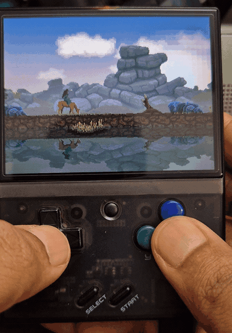
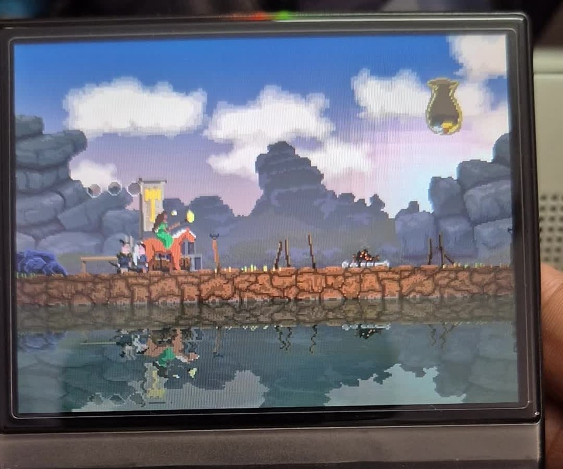

*Kingdom: New Lands* is one of the most atmospheric indie strategy games ever made. Its minimalist side-scrolling exploration, gorgeous pixel art reflections, and simple three-button gameplay make it feel like it was born to be played on a retro handheld.

Yet beneath its retro aesthetic lies a modern Unity engine title (Unity 2017 with Mono backend). Unity games carry substantial runtime overhead: a heavy managed runtime, garbage collection pauses, monolithic asset serialization, and a graphics pipeline expecting modern OpenGL or Vulkan.

The **Miyoo Mini Plus**, running OnionOS, offers a modest dual-core ARM Cortex-A7 clocked at 1.2 GHz, 128 MB of total system RAM, and no hardware 3D GPU. 

Today, I’m releasing **v1.0** of a native, clean-room port of *Kingdom: New Lands* that achieves a smooth, stable 30 FPS on the Miyoo Mini Plus.

<figure>
  
  <figcaption>Kingdom: New Lands running natively on the Miyoo Mini Plus at 30 FPS.</figcaption>
</figure>

---

## The Architecture: Clean-Room Recompilation

Porting a closed-source commercial Unity game without source access requires a hybrid recompilation approach:

```
Your PC Game (Steam / Epic / GOG)
   │
   ├── Kingdom_Data/ (Assets) ──► tools/convert.py ──► pack.py ──► kingdom.knlpack (~38 MB)
   │
   └── Assembly-CSharp.dll (Game Logic)
            │
            ▼ (Runs Unmodified on Device via Mono ARMHF)
   ┌────────────────────────────────────────────────────────┐
   │                  Game Logic Layer                      │
   ├────────────────────────────────────────────────────────┤
   │ UnityEngine.dll & Rewired_Core.dll (Clean-Room Engine) │
   ├────────────────────────────────────────────────────────┤
   │ libknlcore.so (Software Blitter, Box2D, Audio Mixer)   │
   └────────────────────────────────────────────────────────┘
            │
            ▼
   Miyoo Mini Framebuffer (/dev/fb0) & Audio (/dev/mi_ao)
```

1. **Unmodified Game Bytecode**: The original game logic assembly (`Assembly-CSharp.dll`) is executed directly on the device using an optimized ARM hard-float build of the Mono 6.8 runtime.
2. **Clean-Room Engine (`UnityEngine.dll`)**: A custom, lightweight C# implementation of the subset of the Unity engine API used by *Kingdom: New Lands* (GameObject hierarchies, Transform trees, 2D physics, sprite rendering, audio sources, animation states, and coroutines).
3. **Clean-Room Input (`Rewired_Core.dll`)**: A drop-in replacement for the proprietary Rewired input system, mapping hardware input events directly to game actions.
4. **Native C Core (`libknlcore.so`)**: A high-performance C backend handling 320×240 software sprite rasterization, 2× pixel scaling to the 640×480 screen, multi-core multithreaded frame presentation, and hardware audio mixing via SigmaStar MI libraries.

---

## Overcoming the 128 MB RAM Ceiling

The Miyoo Mini’s 128 MB of shared RAM was our strictest constraint. A standard desktop launch of *Kingdom: New Lands* uses over 250 MB of memory just to deserialize asset bundles, level definitions, and sprite atlases. On Linux, exceeding 100 MB of heap space immediately triggers the out-of-memory (OOM) killer.

To solve this, we created a custom asset pipeline:

- **Offline Asset Packaging (`kingdom.knlpack`)**: A Python-based extractor inspects `Kingdom_Data/`, parses 16,880 Unity objects, extracts 2,205 sprites, and strips away all desktop textures and unused metadata.
- **Binary Format**: The assets are packed into a single linear binary package. Textures are indexed directly into 8-bit palette-indexed representations, and sound effects are compressed to ADPCM.
- **Streamed Vorbis Audio**: 43 ambient and musical tracks are streamed on demand from the microSD card rather than preloaded into RAM.

The result? The total device memory footprint dropped from over 250 MB to just **38 MB of managed heap** and **73 MB of total system RSS**, leaving plenty of headroom for the operating system and audio buffers.

---

## Physics & Deep Engine Quirks

Building a clean-room engine reveals subtle behaviors that you take for granted in full-scale engines.

### 1. The Concave Coin Bag Collider
In *Kingdom*, your coin pouch is not an abstract UI counter; it is a simulated physical container with dynamic coins bouncing around inside it. The bag's boundary is defined by a 15-vertex concave `PolygonCollider2D`.

During early builds, dropped coins would fall straight through the inner bowl and settle along a flat line outside the pouch. The problem was edge normal resolution: when a falling coin slightly penetrated an edge, naive normal checking inverted the normal vector, propelling the coin deeper into the solid wall rather than repelling it upward into the cavity.

By computing the signed area of the polygon vertices ($Area = \frac{1}{2} \sum (x_i y_{i+1} - x_{i+1} y_i)$), we guaranteed consistent outward-facing normals across concave cavities, allowing coins to settle naturally into the curved leather pouch bowl.

<figure>
  
  <figcaption>The coin bag resting properly in the top-right corner with coins naturally nestled in the bowl.</figcaption>
</figure>

### 2. The Shared MaterialPropertyBlock Bug
When walking near a buildable structure (like a campfire or wall), the King and surrounding trees would suddenly flash white.

In the original decompiled bytecode, the highlight helper `SpriteFX` used a single `static MaterialPropertyBlock _materialBlock`. In naive implementations, storing a reference to `_materialBlock` causes all renderers across the game to share the exact same dictionary in memory. When a payable structure set its `_Overlay` color to white, the King and nearby trees read that overlay and flashed along with it. Deep-copying property blocks on assignment isolated each renderer's properties.

---

## Handheld Ergonomics

Kingdom was originally designed for two arrow keys (left/right) and a down key to pay. On a vertical handheld like the Miyoo Mini Plus, pressing down on the D-pad while trying to ride left or right is awkward and strains the thumb.

In our Rewired mapping layer:
- **A Button**: Drop coins and pay into structures.
- **D-pad Down**: Also supported for traditionalists.
- **B Button & L / R Shoulders**: Gallop / sprint.
- **D-pad Left / Right**: Ride and explore.

This enables a relaxed two-handed grip where the left thumb steers and the right thumb effortlessly manages your treasury.

---

## Try it Out

The port is available now under a **Bring Your Own Data (BYOD)** model. You provide your own copy of *Kingdom: New Lands* from Steam, Epic Games, or GOG, and the build tools do the rest.

- **GitHub Repository**: [github.com/devarshi16/kingdom-miyoo](https://github.com/devarshi16/kingdom-miyoo)
- **v1.0 Release Archive**: Available on the [Releases page](https://github.com/devarshi16/kingdom-miyoo/releases).
