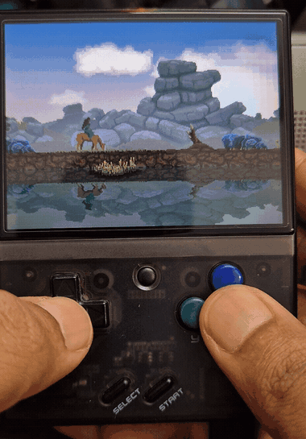

*Kingdom: New Lands* is now playable natively on the Miyoo Mini and Miyoo Mini Plus handhelds running OnionOS!

<figure>
  
  <figcaption>Kingdom: New Lands running live on the Miyoo Mini Plus at 30 FPS.</figcaption>
</figure>

## Highlights

- **Native performance**: 30 FPS at native 320×240 resolution with 2× hardware framebuffer scaling on the 640×480 IPS display.
- **Handheld controls**: Comfortable handheld ergonomics using the A button or D-pad Down to pay/drop coins, and shoulder triggers (L/R) or B to gallop.
- **Custom audio mixer**: Low-latency software audio mixer streaming Vorbis music and mixing ADPCM sound effects.
- **Compact device format**: Custom asset pipeline reduces memory footprint from 256 MB down to ~38 MB to run comfortably within the device's 128 MB RAM limit.
- **BYOD (Bring Your Own Data)**: Fully legal and clean-room implementation compatible with official PC assets from Steam, Epic Games, or GOG.
